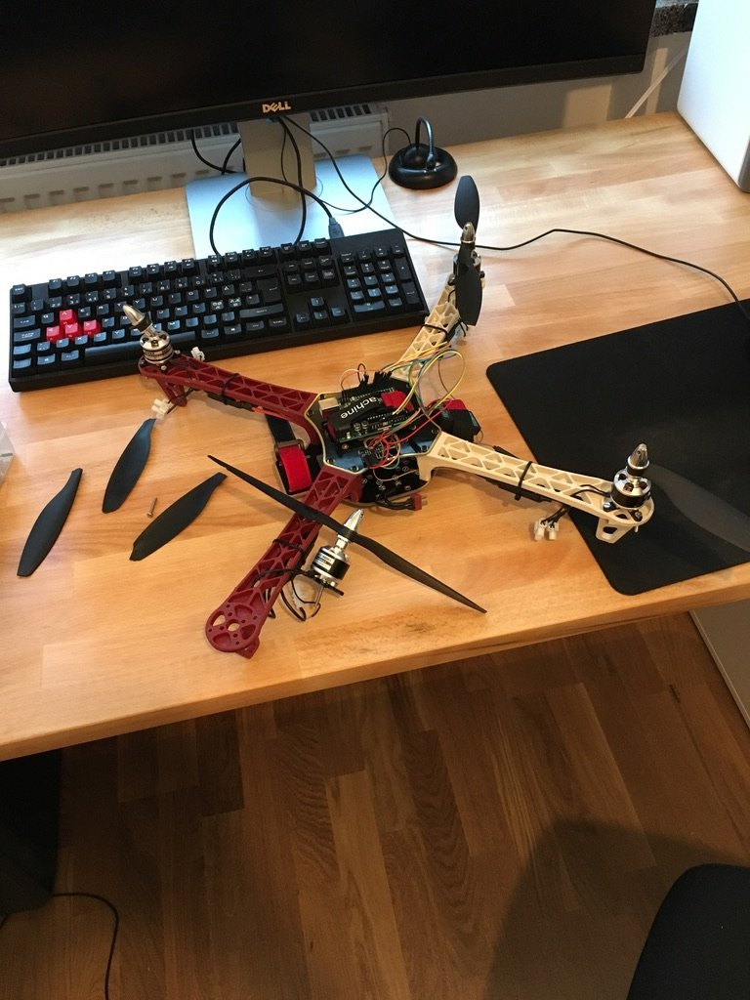

Rammen, motorene og elektronikken ble satt sammen fra bunnen. En Arduino med flykontroller fra åpen kildekode holdt dronen i lufta.

Den fløy én tur. Jeg hadde ikke brukt låsemuttere, så flere av mutterne som holdt motorene løsnet under den første flyturen, og dronen krasjet. Nye deler ble bestilt, men den ble aldri reparert.

Lærdommen: bruk låsemuttere på alt som vibrerer.
