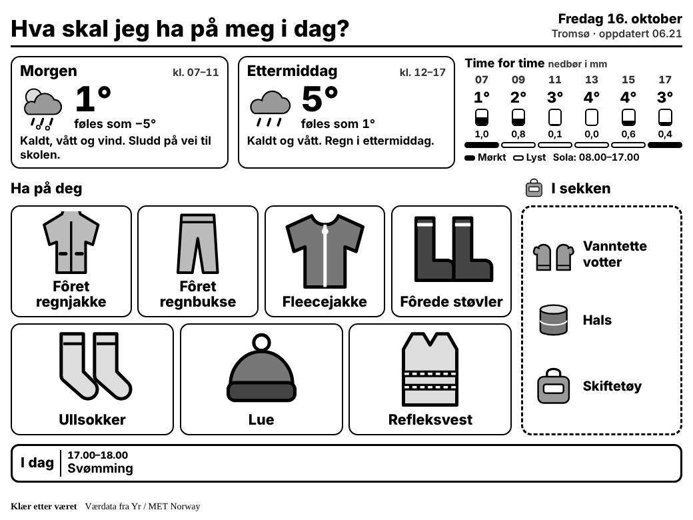

Hva skal jeg ha på meg i dag? Svaret står på en [TRMNL](https://trmnl.com)-skjerm i gangen. Skjermen er en liten e-blekk-skjerm som oppdateres av seg selv, og den viser været for morgenen og ettermiddagen og hva barna bør ha på seg.

## Hva skjermen viser

- Været om morgenen og om ettermiddagen, og temperatur og nedbør time for time.
- **Ha på deg**: klærne som trengs om morgenen, som store bildekort.
- **I sekken**: ting som bare trengs senere på dagen.
- Dagens avtaler fra kalenderen, og påminnelser som refleksvest når det er mørkt.

Etter klokken 17 bytter skjermen til planen for neste dag.

## Slik er det laget

Værdataene kommer fra Yr (MET Norway), og snødybden fra NVEs seNorge. Reglene for klær er skrevet i JavaScript. Det blir for eksempel fôret regntøy ved 6 grader eller kaldere, og votter ved 4 grader eller kaldere. Vinterdress foreslås bare når det ligger nok snø, fordi den ellers blir slitt i stykker på bar bakke.
