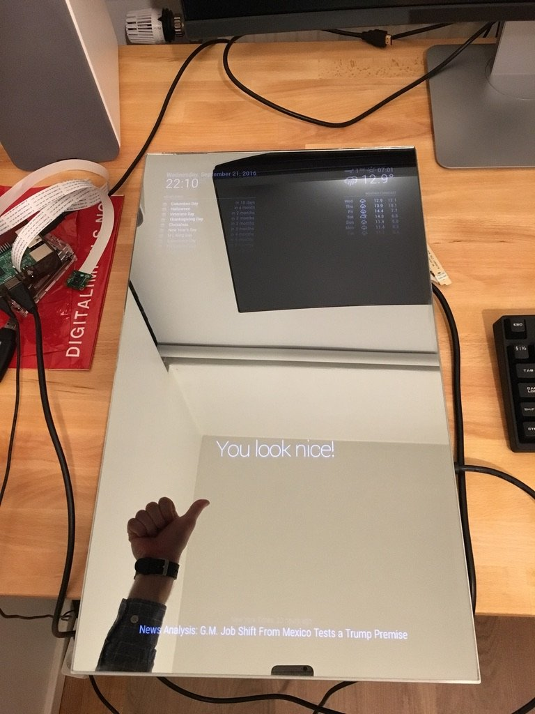
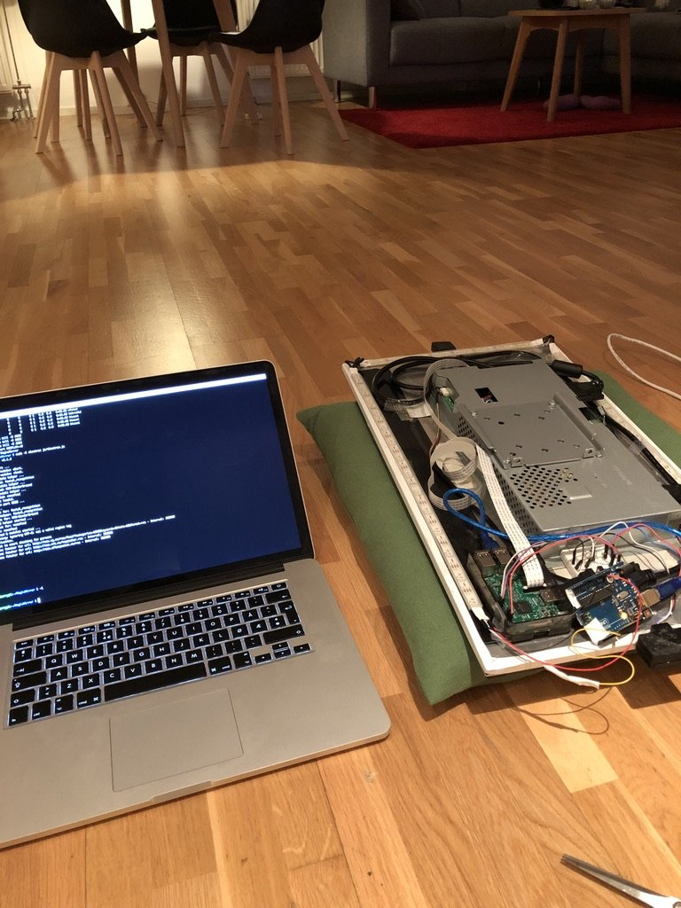
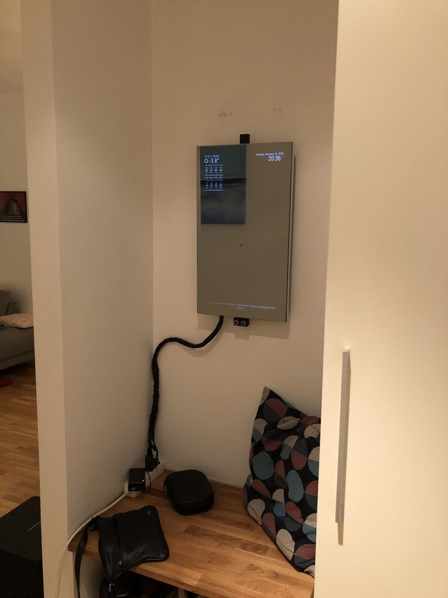

Bak et toveisspeil sitter en skjerm, en Raspberry Pi med kamera og en avstandssensor. Når noen kommer nær nok, slås skjermen og lyset rundt rammen på. Kameraet tar et bilde, og Microsofts ansiktsgjenkjenning (Azure Face API) finner ut hvem i husstanden det er. Speilet hilser deg med navn, og ukjente får en egen hilsen.

Skjermen kjører [MagicMirror²](https://magicmirror.builders) med klokke, værvarsel og nyheter. Ansiktsgjenkjenningen er en egen modul skrevet i Python og JavaScript. En Arduino styrer LED-stripen rundt rammen.

Speilet hang i gangen til vi pusset opp leiligheten. Da ble det tatt ned, og det har ikke blitt hengt opp igjen.

